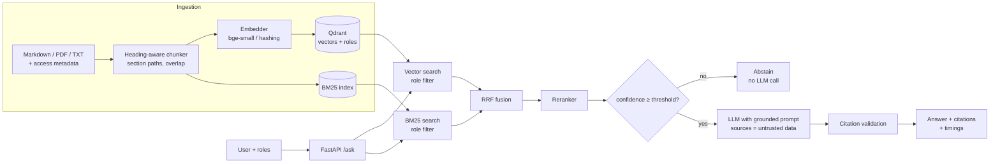

# Enterprise Knowledge Copilot

[](https://github.com/Tanzil-Ali-Rizvi/enterprise-knowledge-copilot/actions/workflows/ci.yml)


[](https://tanzil-knowledge-copilot.streamlit.app)

**A production-style RAG assistant that answers employee questions from company documents — with citations, role-based access control, abstention when it doesn't know, and an evaluation suite that gates every commit.**

> Employees at a typical company spend hours a week hunting through policies, runbooks and wikis. This copilot answers in milliseconds, shows exactly which document each sentence came from, and **never reveals a document the asking user isn't cleared to read** — even if a document contains a prompt-injection attack.

### ▶️ [Try the live demo](https://tanzil-knowledge-copilot.streamlit.app)

Ask *"What were Q3 revenue and EBITDA?"* as **Priya (Engineer)**: the copilot refuses, because she can't read board documents. Switch the sidebar to **Rohan (CEO)** and ask again: it answers with a citation. *(Free hosting sleeps when idle; the first load may take a minute.)*

---

## Highlights

| | |
|---|---|
| 🔎 **Hybrid retrieval** | Dense vectors (Qdrant) + BM25 keywords, merged with Reciprocal Rank Fusion |
| 🎯 **Reranking** | Cross-encoder (ms-marco MiniLM) or an offline lexical reranker |
| 📎 **Cited answers** | Every sentence cites its source; hallucinated citation numbers are stripped |
| 🔐 **Access control at retrieval time** | The LLM never sees chunks the user can't read, so prompt injection can't leak them |
| 🧱 **Injection guardrail** | Instruction-like sentences in documents are quarantined at ingestion and logged |
| 🛑 **Calibrated abstention** | Low-confidence questions get "I don't know" *without* an LLM call (safer and cheaper) |
| 📊 **Evaluation harness** | 44-case golden set: hit@k, MRR, answer & citation accuracy, abstention, ACL leak rate, latency |
| 🚦 **CI quality gates** | Lint, tests, secret scanning, Docker build, and the eval gate on every push |
| 🔌 **Any LLM, no lock-in** | Ollama (local/private), Groq, Gemini, OpenAI, vLLM… switch with one env var |
| 💸 **Runs free** | Fully offline mode needs no API key and no model download |

## Architecture



**Why these choices**

- **Hybrid over vector-only** — exact terms that matter in enterprise docs (`CERT-In`, `P1`, `INR 9,000`, product names) are often missed by embeddings; BM25 catches them, vectors catch paraphrases. RRF merges the two without tuning score scales.
- **ACL in the retriever, not the prompt** — asking an LLM to "not reveal" restricted text is not a security control. Filtering happens inside Qdrant and BM25 *before* generation, and is re-checked on the final set (defence in depth).
- **Abstain before generating** — if the best reranked chunk is below `KC_MIN_CONFIDENCE`, the system answers "I don't know" immediately. This removes the most common source of hallucinations and saves the LLM cost on unanswerable questions.
- **Two layers against prompt injection** — instruction-like sentences are quarantined at ingestion (`guardrails.py`), and retrieved text is still wrapped as untrusted data with an explicit instruction to ignore embedded commands. The corpus deliberately contains an injection fixture to test both.

## Evaluation results

Golden set: **44 cases** across factual lookup, paraphrase, access-control allowed / denied, prompt injection and out-of-scope questions ([`evals/golden.jsonl`](evals/golden.jsonl)).

**Neural configuration** (bge-small-en-v1.5 embeddings + ms-marco MiniLM cross-encoder, run in CI on every push):

| Config | hit@1 | hit@5 | MRR | Answer acc. | Citation acc. | Abstention acc. | **ACL leak rate** | p50 latency |
|---|---|---|---|---|---|---|---|---|
| BM25 only | 0.97 | 1.00 | 0.99 | 0.82 | 0.82 | 1.00 | **0.0** | 0.5 ms |
| Vector only | 0.94 | 0.97 | 0.96 | 0.79 | 0.79 | 1.00 | **0.0** | 9 ms |
| Hybrid (RRF) | 1.00 | 1.00 | 1.00 | 0.85 | 0.85 | 1.00 | **0.0** | 9 ms |
| **Hybrid + cross-encoder** | **1.00** | **1.00** | **1.00** | **0.88** | **0.88** | 1.00 | **0.0** | 338 ms (CPU) |

**Fully offline configuration** (hashing embedder, lexical reranker — no network, no model download, no API key):

| Config | hit@1 | hit@5 | MRR | Answer acc. | Citation acc. | Abstention acc. | **ACL leak rate** | p50 latency |
|---|---|---|---|---|---|---|---|---|
| BM25 only | 0.97 | 1.00 | 0.99 | 0.82 | 0.82 | 1.00 | **0.0** | 0.4 ms |
| Vector only | 0.97 | 1.00 | 0.99 | 0.82 | 0.82 | 1.00 | **0.0** | 2.5 ms |
| Hybrid (RRF) | 1.00 | 1.00 | 1.00 | 0.82 | 0.82 | 1.00 | **0.0** | 3.1 ms |
| Hybrid + lexical rerank | 0.97 | 1.00 | 0.99 | 0.88 | 0.88 | 1.00 | **0.0** | 5.6 ms |

Both tables use the offline extractive answerer so results are deterministic and free to reproduce.

**What the numbers say**

- **Hybrid beats either retriever alone.** Vector-only misses exact terms; BM25-only misranks paraphrases. Fusion plus the cross-encoder gives perfect ranking on this set (hit@1 = MRR = 1.0).
- **Zero access-control leaks** across every denied-access and prompt-injection case, in every configuration.
- **Perfect abstention:** every out-of-scope and forbidden question gets "I don't know" instead of a guess.
- **The remaining misses are generation, not retrieval.** The right chunk is ranked first, but questions like *"Is a beer with dinner reimbursable?"* share no words with *"Alcohol is never reimbursable"*, so the word-overlap answerer abstains. Plugging in an LLM (`KC_LLM_PROVIDER=openai`) is the next step for these; the cross-encoder's ~340 ms CPU cost is the latency trade-off for perfect ranking (a GPU or a smaller candidate set brings it down).

Full report: [`evals/results/report.md`](evals/results/report.md). Reproduce with `make eval`.

## Quickstart

```bash
git clone https://github.com/Tanzil-Ali-Rizvi/enterprise-knowledge-copilot.git
cd enterprise-knowledge-copilot
python -m venv .venv && source .venv/bin/activate   # Windows: .venv\Scripts\activate
pip install -e ".[neural,ui,dev]"
cp .env.example .env                                 # optional: choose embedder / LLM

# Ask from the command line
kcopilot ask "What is the hotel limit in Mumbai?" --user priya
kcopilot ask "What was Q3 revenue?" --user priya     # -> abstains: engineers can't read board docs
kcopilot ask "What was Q3 revenue?" --user rohan     # -> answers with citation: the CEO can

# Chat UI (switch users in the sidebar to watch access control in action)
streamlit run ui/app.py

# REST API with Swagger docs at http://localhost:8000/docs
uvicorn kcopilot.api:app --reload
curl -s localhost:8000/ask -H "X-User-Id: priya" -H "Content-Type: application/json" \
     -d '{"question": "How quickly must a P1 incident be acknowledged?"}'
```

**Docker:** `docker compose up --build` (API on :8000, UI on :8501). Add `--profile llm` to also run Ollama locally.

### Use a real LLM (all free options)

Set in `.env` — any OpenAI-compatible endpoint works:

| Provider | `KC_LLM_BASE_URL` | Example `KC_LLM_MODEL` | Privacy |
|---|---|---|---|
| Ollama | `http://localhost:11434/v1` | `llama3.2:3b` | 100% local |
| Groq | `https://api.groq.com/openai/v1` | `llama-3.1-8b-instant` | Cloud, free tier |
| Gemini | `https://generativelanguage.googleapis.com/v1beta/openai` | `gemini-2.0-flash` | Cloud, free tier |

plus `KC_LLM_PROVIDER=openai` and `KC_LLM_API_KEY=...`.

## Demo users

| User | Roles | Can read |
|---|---|---|
| `priya` | employee, engineering | Company-wide policies, engineering runbooks |
| `arjun` | employee, hr | Company-wide policies, compensation bands |
| `kavya` | employee, finance | Company-wide policies, procurement |
| `rohan` | exec, finance, hr | Everything incl. board summary |
| `admin` | admin | Company-wide policies + `/admin/reindex` |

The sample corpus is for **Northwind Pay, a fictional Indian fintech** — 13 synthetic documents (HR, finance, IT security, engineering, product, legal, executive). No real company data.

## Project structure

```
src/kcopilot/
  ingest.py       # loaders (md/pdf/txt), front-matter ACLs, heading-aware chunking
  guardrails.py   # prompt-injection quarantine at ingestion
  embeddings.py   # fastembed (bge-small) or offline hashing embedder
  index.py        # Qdrant + BM25 hybrid index with role filters, embedding cache
  retrieval.py    # Reciprocal Rank Fusion, cross-encoder & lexical rerankers
  security.py     # users, roles, can_read()
  llm.py          # OpenAI-compatible client + offline extractive answerer
  generation.py   # grounded prompt, citation validation
  pipeline.py     # Copilot: retrieve -> rerank -> abstain|generate -> cite
  api.py          # FastAPI service
  evaluation.py   # metrics, config comparison, CI quality gates
ui/app.py         # Streamlit chat UI
evals/            # golden set + latest report
tests/            # unit, security (ACL + injection), API, eval-gate tests
```

## Production considerations

- **Identity:** the demo `X-User-Id` header stands in for a verified OIDC/JWT token; `UserDirectory` is the single place to plug in SSO group claims.
- **Scale:** set `KC_QDRANT_URL` to use a Qdrant server or Qdrant Cloud instead of in-process vectors; BM25 can move to OpenSearch/Elasticsearch for millions of chunks.
- **Observability:** every request logs a structured JSON line (user, roles, confidence, abstained, per-stage latency) ready for Langfuse/Datadog/OpenTelemetry.
- **Cost control:** abstention skips the LLM call entirely; `usage` token counts are returned per answer.
- **Freshness:** documents carry an `updated` date; `/admin/reindex` rebuilds the index (admin role only).

## Roadmap

- [ ] Langfuse tracing and per-user cost dashboard
- [ ] Incremental indexing from Google Drive / SharePoint / Confluence
- [ ] LLM-as-judge faithfulness scoring and an LLM-backed eval run in CI
- [ ] Query rewriting for multi-turn follow-ups

## License

MIT © 2026 Tanzil Ali Rizvi
